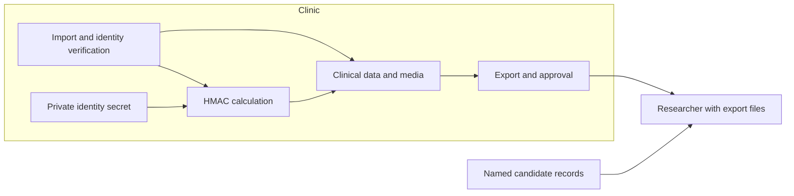

# Linkage and Identification

## Executive summary

The current implementation is able to link patients based on deterministic hashes that are secret bound. Therefore, the linkage is bound to the distribution of secrets and the correctness of data entry.

## Scope and assumptions

The local working tree based on commit
`08c1ac0da110343dfc6d0314b24998a1937d9aeb` was reviewed, including extensive
preexisting changes. This makes no claim about a deployed server or its database
migration state. Other agents are editing the same tree; key rotation in
particular is being developed concurrently.

The user confirmed this recipient model: a researcher receives exports, knows
the algorithms, and may possess named candidate records or source files. The
researcher has no access to clinic keys, the database, or a tokenization service.
The review covers hash helpers, demographic identity resolution, selected
dataset, case, and CSV exports, and their immediate callers. It does not cover
all API authorization, actual key entropy, production files, real reidentification
rates, or legal anonymity. Tests use their existing test data; production secrets
were not read.

Scope and production readiness remain exclusively in
[Anonymization.yml](../feature-tracking/Anonymization.yml), particularly
`documented_scope`, `privacy_controls`, `sensitive_metadata_resolution`, and
`strict_legacy_hmac_inventory`. This report is a technical reference, not a
parallel approval tracker. The [report of October 16, 2026](../feature-tracking/reports/sensitive_meta_hash_security.md)
remains as a historical investigation.

Open questions include which export variants researchers actually receive,
their permitted linkage scope across studies, production migration state, and
empirical misattribution/identification rates.

## System model

### Primary components

Python/Django services calculate identities and generate exports; typed lx-dtypes
contracts validate data shapes. The current patient value is:

```text
K = UTF-8 of the validated active identity secret
x = UTF-8(JSON(["patient-identity-v1", trim(first_name), trim(last_name),
               ISO(date_of_birth), trim(center_key)],
              ensure_ascii=False, separators=(",", ":")))
patient_hash = hex(HMAC-SHA-256(K, x))
```

Evidence: `endoreg_db/utils/hashs.py:31`, `:53`, `:75`, `:99`;
`endoreg_db/models/metadata/sensitive_meta_logic.py:304` returns the HMAC directly.
The examination hash binds the patient HMAC, examination date, and center in a
second, separately tagged HMAC message (`hashs.py:125`). The patient message
contains no study or recipient identifier.

### Data flows and trust boundaries

- Imported data → clinical identity resolution: names, date of birth, and center
  pass through validation and database transactions. Historical resolution checks
  center and conflicts (`services/patient_identity/hash_aliases.py:28`).
- Private configuration → hash service: key material from private files or a
  registered keyring; invalid active values fail explicitly
  (`config/identity_hashing.py:43`, `utils/verify_salt.py:31`). Minimum length and
  character diversity do not prove random generation. Historically registered
  read keys are explicitly exempt (`utils/hashs.py:38`).
- Protected database/media → export file → researcher: JSON, CSV, XLSX, and
  processed media. The dataset service removes `sensitive_meta` during outer JSON
  serialization (`services/datasets/exports.py:346`); internal intermediate
  objects still contain these data. Artifact generation uses exactly this
  serialization (`services/application_settings/ai_dataset_export.py:392`).
- Processed video → download: approval and content integrity are checked; active
  downloads bind their lease to the generation
  (`services/media/export_policy.py:32`, `export_downloads.py:27`). This does not
  automatically assess identifiability of the associated tables.

Transport configuration and actual access rights were not verified as runtime
evidence. In this model the attacker already receives the files legitimately;
authentication or transport encryption does not prevent local comparison.

#### Diagram



## Assets and security objectives

| Asset | Significance | Objective |
|---|---|---|
| Identity secret and mapping | Prevent independent candidate token calculation | Confidentiality |
| Patient/examination linkage | Incorrect merging corrupts clinical data | Integrity |
| Exported content and linkage graph | Disclosure can identify all linked findings | Confidentiality |
| Registered media identity | Recognize identical bytes and detect tampering | Integrity |

## Attacker model

### Capabilities

Compare received files, hash known originals, recognize names in filenames,
combine releases, and use supplementary clinical knowledge.

### Non-capabilities

No clinic keys, database queries, unrestricted tokenization queries, or changes
to the trusted digest inventory. Key compromise is treated as a limit of the
token claim, not a prerequisite for the main findings.

## Entry points and attack surfaces

| Surface | Reachability / boundary | Relevant content | Evidence |
|---|---|---|---|
| AI dataset JSON | Delivered research artifact | `sensitive_meta` removed; `raw_video_hash`, `original_file_name`, paths, timestamps, and IDs remain in frame entries | `services/datasets/exports.py:101`, `:346` |
| Patient video in dataset | Part of the same artifact | `external_ids.raw_video_hash`, processed hash, patient/examination ID, file path | `services/video_files/clinical_contracts.py:312` |
| Annotation CSV | Browser/file export | Raw hash alongside processed artifact identity | `export/frames/export_frames_with_labels.py:112`, `:1672`; `services/media/export_downloads.py:50` |
| Timestamp CSV | Export with `original=True` | Digest of the stored original timestamp sequence; comparable only with matching original bytes | `services/media/export_downloads.py:61` |
| Case JSON/XLSX | Selected pseudonymous cases | Unchanged patient pseudonym, center, revisions, clinical snapshots, and times | `services/studies/revision_export.py:58`, `:138` |

In normal import, a stored raw hash comes from the source file hash
(`import_files/video_import_service.py:283`, `file_storage/create_video_file.py:155`).
For transformed generations, always establish exactly which bytes a digest
references. Not every digest matches every version of the same recording.

## Top abuse paths

1. Researcher knows a named original → calculates its SHA-256 → compares
   `raw_video_hash` → identifies the export record and linked findings.
2. Original filename or path contains patient information → researcher reads
   the exported value → direct attribution without a cryptographic attack.
   Whether actual files have such names was not checked.
3. A finding is clinically recognizable → stable patient/case identifier links
   further findings → identification spreads across the group.
4. Multiple study exports contain the same patient hash or IDs → researcher
   links releases → more supplementary knowledge per person.
5. Two people have the same demographic tuple, or one person has spelling
   variants → identical or different tokens despite a different person relation
   → false merge or split. This is a data quality error, not an HMAC attack
   required by the recipient.

## Threat model table

| Threat ID | Threat source | Prerequisites | Threat action | Impact | Impacted assets | Existing controls (evidence) | Gaps | Recommended mitigations | Detection ideas | Likelihood | Impact severity | Priority |
|---|---|---|---|---|---|---|---|---|---|---|---|---|
| TM-001 | Recipient | Matching named original bytes | Raw hash comparison | Identity attribution | Findings confidentiality | Processed media checked; `export_policy.py:32` | Raw hash remains in export | Keep original fingerprints internal; external object identifiers per release scope | Export field inventory and candidate file test | high with matching bytes | high | high |
| TM-002 | Recipient | Identifying name/path actually present | Read metadata | Direct identification | Identity | `sensitive_meta` excluded; `exports.py:369` | Other string fields remain | Explicit research allowlist and sanitized artifact names | Negative test with identifying source filename | medium, inventory-dependent | high | high |
| TM-003 | Recipient | Recognizable finding or linkable earlier release | Combine clinical features and stable IDs | Group-wide attribution | Linkage graph | Human media approval | No general auxiliary-information/composition guarantee | Review complete export and cumulative releases; study-specific identifiers | Recipient-specific attack attempts, individual case analysis | medium, data-dependent | high | high |
| TM-004 | Clinical input | Homonyms or variants | Treat demographic equality as person equality | False merges / false splits | Linkage integrity | Structured encoding; center-bound conflict checks | No unique person source in demographic token | Verified identity source and domain ambiguity process | Reference corpus with clinically confirmed identities | not quantified | high | medium |
| TM-005 | Operational/publication assumptions | Legacy inventory or old assessment used as current evidence | Assume incorrect construction or migration | Unsupported security claim | Evidence quality | Migration service and feature evidence exist | Production application not checked | Establish key generation and migration separately; label historical findings | Inventory review without identifiers in report | medium | medium | medium |

Table priorities concern the confirmed research model. TM-001 is not demonstrated
unauthorized server exfiltration; critical disclosure arises from the contents
of an authorized export.

## Criticality calibration

`critical` would mean immediate broad disclosure of direct identities or clinic
keys; neither was demonstrated here. `high` covers the reproducible original-file
comparison and identifying export metadata. `medium` covers unquantified
demographic linkage errors and outdated evidence documentation. `low` would
cover naming errors or documentation ambiguity without additional disclosure;
these do not drive the main assessment.

## Assessment of the requested claims

| Claim | Assessment in current code |
|---|---|
| Identical complete inputs yield the same patient value | Supported with the same key and center. Outer whitespace is trimmed. |
| The same real person is always recognized correctly | Not proven. Case, Unicode variants, name changes, and changed dates of birth can split identities; homonyms can merge. |
| Legacy field concatenation ambiguity affects the current HMAC | No. JSON field boundaries resolve this specific ambiguity. Legacy migration and historical aliases still require separate checks. |
| The researcher can calculate candidate tokens from demographics alone | Not possible for the current HMAC under the confirmed model, provided the secret is sufficiently random and protected. |
| Tokens disclose only equality information | Defensible as a conditional token-layer statement; no claim about the rest of the export view. |
| Tokens are study-specific | Not in the examined patient path: no study identifier; the same stored value is exported. |
| File hashes reliably recognize files | They compare exact bytes; `get_file_hash` processes an authenticated plaintext stream or stable local file identity. This does not prove semantic equality of re-encoded files. |
| File hashes prevent patient identification | False when a matching named original and published digest are available. |
| Complete exports are anonymous / reidentification is impossible | Unsupported; the described comparison paths contradict an unconditional claim. |

### Conditional cryptographic claim

HMAC is a secret-bound construction; its pseudorandom function (PRF) property
requires cryptographic assumptions and sufficiently random keys. It does not
follow from collision resistance alone. Sources:
[RFC 2104](https://www.rfc-editor.org/rfc/rfc2104),
[Bellare, New Proofs for NMAC and HMAC](https://eprint.iacr.org/2006/043).

Under this assumption, a simulator for the current patient function can assign
an independently random 256-bit value to each distinct normalized input tuple
and return it again on repetition. Distinguishing this from the real token vector
is bounded by the corresponding PRF advantage. All remaining export information
belongs in the modeled auxiliary information Z. In particular, other outputs
under the same key, known identity/token pairs, and previous releases must be
included in a complete joint model. A proof for the patient vector alone is not
a proof for the composed application.

Labels must be sampled independently, rather than made artificially collision-free:
for n distinct inputs, the ideal collision bound is `n(n-1)/2^257`, approximately
`4.32 × 10^-66` for one million, plus the reduction error from the PRF assumption.
This is not a reidentification rate. The “collision-free” docstring in
`utils/hashs.py:83` is therefore too strong.

Configuration validation rejects short and obviously weak active values. An
empirical byte-entropy check does not prove 256 bits of key entropy; random
provisioning remains an operational assumption. Candidate checking still works
with a known key, as the existing synthetic date-of-birth test demonstrates.

### Remaining content and release procedures

Removing `sensitive_meta` at the actual AI export is an effective existing
control; the internal presence of this object is not reported here as actual
name leakage. Raw hashes, filenames, and paths are not covered by that exclusion.
Case revisions are exported as clinical snapshots, without a general anonymity
proof. The internal pseudopatient profile also retains birth month and year
(`models/administration/person/patient/patient.py:125`); this is a recipient risk
only if a concrete export contains these values.

The existing k-pseudonymity function is a separate configurable table workflow
(`services/privacy/k_pseudonymity.py:93`). The examined dataset and case exporters
do not call it. Its existence therefore does not establish that property for
these exports. No empirical identification attempts against actual export
inventories were conducted either.

## Focus paths for security review

| Path | Purpose | Findings |
|---|---|---|
| `endoreg_db/services/datasets/exports.py` | Review a research allowlist instead of merely removing a nested object | TM-001–003 |
| `endoreg_db/export/frames/export_frames_with_labels.py` | Review raw hash and paths in CSV contract | TM-001–002 |
| `endoreg_db/services/studies/revision_export.py` | Assess study, stable identifiers, and full snapshot contents together | TM-003 |
| `endoreg_db/utils/hashs.py` | Input semantics, key binding, and precise security terminology | TM-004–005 |
| `endoreg_db/services/secret_rotation/legacy_hashes.py` | Separate migration evidence from actual inventory state | TM-005 |

## Notes on use

### Verification actually performed

```sh
.devenv/state/venv/bin/pytest tests/utils/test_sensitive_meta_hash_security.py tests/utils/test_file_hash_integrity.py tests/environment/test_identity_hashing.py -q --tb=short --show-capture=no
.devenv/state/venv/bin/pytest tests/services/test_lx_video_contracts.py::test_ai_dataset_json_export_omits_sensitive_meta tests/models/test_dataset_export_scope.py tests/services/test_patient_identity_input_variations.py -q --tb=short --show-capture=no
.devenv/state/venv/bin/python scripts/lint_structure.py
./feature-tracking/tracker.py validate
./feature-tracking/tracker.py show anonymization
```

First run: **49 passed**, one plugin warning, 0.57 seconds test time.
Second run: **33 passed, 12 failed**, 133 warnings, 67.13 seconds. Export scope
tests and the test for actual removal of `sensitive_meta` passed. All twelve
failures are in `test_patient_identity_input_variations.py`: ten name variants
and the examination date test fail because the fixture has an unsaved center
without `center_key`; the remaining test expects outer whitespace to produce
different hashes, contrary to the current implementation. Failures were not
changed and are not successful linkage evidence. Pytest also reported cleanup
warnings for preexisting temporary directories in both runs. No manual cleanup
was performed.

65 structure manifests and 37 feature definitions validated successfully;
`tracker.py show anonymization` was read without changing status.
`git diff --check` passed for changed documentation paths. No Pyright run:
only documentation and its YAML map changed. No new full import, PostgreSQL
concurrency, or migration verification; existing tracker evidence does not
replace a fresh run here. Another owner's running pytest suite was detected
and left uninterrupted; no additional broad suite was started.

This review changes no application, database, keys, or approval status.
Build/CI security is outside the recipient model. All listed export surfaces
and data transitions were examined at source level; a complete inventory of
all interoperability formats is not included. The user confirmed the recipient
model. Production and empirical limits remain explicitly open.

Defensible manuscript wording: “The implementation uses structured, center-bound
HMAC-SHA-256 pseudonyms for deterministic linkage. Token protection requires
secret, randomly generated key material. Domain linkage quality and identifiability
of complete exports are separate properties. Current export contracts allow,
among other things, recognition of matching known source files through published
digests.”
