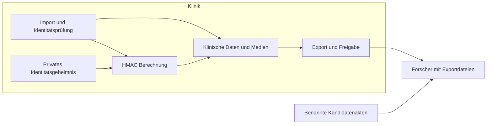

# Verknüpfung und Identifizierbarkeit: Implementierungsprüfung vom 19.10.2026

## Executive summary

Die aktuelle Implementierung unterstützt deterministische, geheimnisgebundene
Patientenverknüpfung. Die frühere Beschreibung als Doppel-SHA-256 mit mehrdeutiger
Feldverkettung trifft auf den aktuellen demografischen Schreibpfad nicht mehr zu.
Ein Nachweis vollständiger Anonymität folgt daraus nicht: Forschungsartefakte
enthalten weiterhin Originaldatei-Hashes, stabile Kennungen und teilweise
Originaldateinamen. Damit sind Identitätszuordnungen durch bekannte Quelldateien
auch ohne Schlüssel möglich. Klinisch korrekte Personenverknüpfung bleibt von
demografischer Eindeutigkeit und Eingabequalität abhängig.

## Scope and assumptions

Geprüft wurde der lokale Arbeitsbaum auf Basis von Commit
`08c1ac0da110343dfc6d0314b24998a1937d9aeb`, einschließlich umfangreicher bereits
vorhandener Änderungen. Dies ist keine Aussage über einen ausgerollten Server
oder den Migrationszustand seiner Datenbank. Andere Agenten bearbeiten denselben
Arbeitsbaum; insbesondere Schlüsselrotation ist parallel in Arbeit.

Der Nutzer bestätigte folgendes Empfängermodell: Ein Forscher erhält Exporte,
kennt Algorithmen und kann benannte Kandidatenakten oder Quelldateien besitzen.
Er hat keinen Zugriff auf Klinikschlüssel, Datenbank oder Tokenisierungsdienst.
Bewertet werden Hashhelper, demografische Identitätsauflösung, ausgewählte
Datensatz-, Fall- und CSV-Exporte sowie deren unmittelbare Aufrufer.
Nicht bewertet werden die gesamte API-Autorisierung, reale Schlüsselentropie,
produktive Dateien, reale Reidentifikationsraten oder rechtliche Anonymität.
Tests verwenden ihre bestehenden Testdaten; Produktionsgeheimnisse wurden nicht gelesen.

Scope und Produktionsreife bleiben ausschließlich in
[Anonymization.yml](../feature-tracking/Anonymization.yml), insbesondere
`documented_scope`, `privacy_controls`, `sensitive_metadata_resolution` und
`strict_legacy_hmac_inventory`. Dieser Bericht ist eine technische Referenz,
kein paralleler Freigabetracker. Der [Bericht vom 16.10.2026](../feature-tracking/reports/sensitive_meta_hash_security.md)
bleibt als historische Untersuchung erhalten.

Offen bleiben die tatsächlich an Forscher ausgelieferten Exportvarianten,
deren erlaubter studienübergreifender Verknüpfungsumfang, der produktive
Migrationsstand und empirische Fehlzuordnungs-/Identifizierungsraten.

## System model

### Primary components

Python/Django-Dienste übernehmen Identitätsberechnung und Export; typisierte
lx-dtypes-Verträge validieren Datenformen. Der Patientenwert ist aktuell:

```text
K = UTF-8 des validierten aktiven Identitätsgeheimnisses
x = UTF-8(JSON(["patient-identity-v1", trim(Vorname), trim(Nachname),
               ISO(Geburtsdatum), trim(center_key)],
              ensure_ascii=False, separators=(",", ":")))
patient_hash = hex(HMAC-SHA-256(K, x))
```

Belege: `endoreg_db/utils/hashs.py:31`, `:53`, `:75`, `:99`;
`endoreg_db/models/metadata/sensitive_meta_logic.py:304` gibt den HMAC direkt
zurück. Der Untersuchungshash bindet Patienten-HMAC, Untersuchungsdatum und
Zentrum in einer zweiten, separat markierten HMAC-Nachricht (`hashs.py:125`).
Ein Studien- oder Empfängerbezeichner gehört nicht zur Patientennachricht.

### Data flows and trust boundaries

- Importdaten → klinische Identitätsauflösung: Namen, Geburtsdatum und Zentrum
  passieren Validierung und Datenbanktransaktionen. Historische Zuordnung prüft
  Zentrum und Konflikte (`services/patient_identity/hash_aliases.py:28`).
- Private Konfiguration → Hashdienst: Schlüsselmaterial aus privaten Dateien
  oder registriertem Schlüsselring; ungültige aktive Werte scheitern explizit
  (`config/identity_hashing.py:43`, `utils/verify_salt.py:31`). Mindestlänge und
  Zeichenvielfalt beweisen keine zufällige Erzeugung. Historisch registrierte
  Leseschlüssel sind ausdrücklich ausgenommen (`utils/hashs.py:38`).
- Geschützte Datenbank/Medien → Exportdatei → Forscher: JSON, CSV, XLSX und
  verarbeitete Medien. Der Datensatzdienst entfernt `sensitive_meta` bei der
  äußeren JSON-Serialisierung (`services/datasets/exports.py:346`); interne
  Zwischenobjekte enthalten diese Daten weiterhin. Die Artefakterzeugung nutzt
  genau diese Serialisierung (`services/application_settings/ai_dataset_export.py:392`).
- Verarbeitetes Video → Download: Freigabe und Inhaltsintegrität werden geprüft,
  laufende Downloads binden ihre Lease an die Generation
  (`services/media/export_policy.py:32`, `export_downloads.py:27`). Das bewertet
  nicht automatisch die Identifizierbarkeit der zugehörigen Tabellen.

Transportkonfiguration und reale Zugriffsrechte wurden nicht als Laufzeitbeweis
geprüft. Der Angreifer erhält die Dateien im Modell bereits rechtmäßig;
Authentifizierung oder Transportverschlüsselung verhindern seinen lokalen Abgleich nicht.

#### Diagram



## Assets and security objectives

| Schutzgut | Bedeutung | Ziel |
|---|---|---|
| Identitätsgeheimnis und Zuordnung | Verhindern eigenständige Kandidatentokenberechnung | Vertraulichkeit |
| Patienten-/Untersuchungszuordnung | Falsche Zusammenführung verfälscht klinische Daten | Integrität |
| Exportierte Inhalte und Verknüpfungsgraph | Offenlegung kann alle verbundenen Befunde identifizieren | Vertraulichkeit |
| Registrierte Medienidentität | Gleiche Bytes erkennen, Manipulation erkennen | Integrität |

## Attacker model

### Capabilities

Empfangene Dateien vergleichen, bekannte Originale hashen, Namen in Dateinamen
erkennen, mehrere Veröffentlichungen verbinden und klinisches Zusatzwissen nutzen.

### Non-capabilities

Keine Klinikschlüssel, Datenbankabfragen, frei nutzbare Tokenisierungsabfragen oder
Änderung des vertrauenswürdigen Digestbestands. Schlüsselkompromittierung wird
als Grenze der Tokenaussage behandelt, nicht als Voraussetzung der Hauptbefunde.

## Entry points and attack surfaces

| Oberfläche | Erreichbarkeit / Grenze | Relevante Inhalte | Beleg |
|---|---|---|---|
| AI-Datensatz-JSON | Ausgeliefertes Forschungsartefakt | `sensitive_meta` entfernt; `raw_video_hash`, `original_file_name`, Pfade, Zeitstempel und IDs bleiben in Frame-Einträgen | `services/datasets/exports.py:101`, `:346` |
| Patientenvideo im Datensatz | Bestandteil desselben Artefakts | `external_ids.raw_video_hash`, verarbeiteter Hash, Patient-/Untersuchungs-ID, Dateipfad | `services/video_files/clinical_contracts.py:312` |
| Annotationen-CSV | Browser-/Dateiexport | Rohhash und verarbeitete Artefaktidentität nebeneinander | `export/frames/export_frames_with_labels.py:112`, `:1672`; `services/media/export_downloads.py:50` |
| Zeitstempel-CSV | Export mit `original=True` | Digest der gespeicherten Original-Zeitstempelfolge; nur mit passenden Originalbytes vergleichbar | `services/media/export_downloads.py:61` |
| Fall-JSON/XLSX | Ausgewählte pseudonyme Fälle | Unverändertes Patientenpseudonym, Zentrum, Revisionen, klinische Snapshots und Zeiten | `services/studies/revision_export.py:58`, `:138` |

Ein gespeicherter Rohhash stammt im normalen Import aus dem Quelldatei-Hash
(`import_files/video_import_service.py:283`, `file_storage/create_video_file.py:155`).
Bei transformierten Generationen muss stets geklärt werden, auf welche exakten
Bytes ein Digest verweist. Nicht jeder Digest passt zu jeder Version derselben Aufnahme.

## Top abuse paths

1. Forscher kennt ein benanntes Original → berechnet dessen SHA-256 → gleicht
   `raw_video_hash` ab → identifiziert Exportdatensatz und verbundene Befunde.
2. Originaldateiname oder Pfad enthält Patienteninformation → Forscher liest
   den exportierten Wert → direkte Zuordnung ohne kryptografischen Angriff.
   Ob konkrete Dateien solche Namen tragen, wurde nicht geprüft.
3. Ein Befund ist klinisch wiedererkennbar → stabile Patient-/Fallkennung
   verbindet weitere Befunde → Identifikation breitet sich auf die Gruppe aus.
4. Mehrere Studienexporte enthalten denselben Patientenhash oder dieselben IDs →
   Forscher verbindet Veröffentlichungen → mehr Zusatzwissen pro Person.
5. Zwei Personen haben dasselbe demografische Tupel oder eine Person hat
   Schreibvarianten → identische bzw. unterschiedliche Token trotz anderer
   Personenrelation → falsche Zusammenführung bzw. Aufspaltung. Dies ist ein
   Datenqualitätsfehler, kein vom Empfänger benötigter HMAC-Angriff.

## Threat model table

| Threat ID | Threat source | Prerequisites | Threat action | Impact | Impacted assets | Existing controls (evidence) | Gaps | Recommended mitigations | Detection ideas | Likelihood | Impact severity | Priority |
|---|---|---|---|---|---|---|---|---|---|---|---|---|
| TM-001 | Empfänger | Passende benannte Originalbytes | Rohhashvergleich | Identitätszuordnung | Befundvertraulichkeit | Verarbeitete Medien geprüft; `export_policy.py:32` | Rohhash bleibt im Export | Originalfingerprints intern halten; externe Objektkennungen pro Freigabebereich | Exportfeld-Inventar und Kandidatendatei-Test | hoch bei passenden Bytes | hoch | high |
| TM-002 | Empfänger | Identifizierender Name/Pfad tatsächlich vorhanden | Metadaten lesen | Direkte Identifikation | Identität | `sensitive_meta` ausgeschlossen; `exports.py:369` | Andere Stringfelder bleiben | Explizite Forschungs-Allowlist und bereinigte Artefaktnamen | Negativtest mit identifizierendem Quelldateinamen | mittel, bestandsabhängig | hoch | high |
| TM-003 | Empfänger | Erkennbarer Befund oder verknüpfbare frühere Freigabe | Klinische Merkmale und stabile IDs verbinden | Gruppenweite Attribution | Verknüpfungsgraph | Menschliche Medienfreigabe | Keine allgemeine Zusatzwissens-/Kompositionsgarantie | Gesamtexport und kumulative Freigaben prüfen; studienspezifische Kennungen | Empfängerbezogene Angriffsversuche, Einzelfallanalyse | mittel, datenabhängig | hoch | high |
| TM-004 | Klinische Eingaben | Homonyme oder Varianten | Demografische Gleichheit als Personengleichheit behandeln | False merges / false splits | Zuordnungsintegrität | Strukturierte Kodierung; zentrumsgebundene Konfliktprüfung | Keine eindeutige Personenquelle im demografischen Token | Verifizierte Identitätsquelle und fachlicher Mehrdeutigkeitsprozess | Referenzkorpus mit fachlich bestätigten Identitäten | nicht quantifiziert | hoch | medium |
| TM-005 | Betreiber-/Publikationsannahmen | Altbestand oder altes Gutachten wird als aktueller Beweis verwendet | Falsche Konstruktion oder Migration voraussetzen | Unbelegte Sicherheitsbehauptung | Nachweisqualität | Migrationsdienst und Feature-Evidenz vorhanden | Produktive Anwendung nicht geprüft | Schlüsselgeneration und Migration separat belegen; historische Befunde kennzeichnen | Bestandsprüfung ohne Identifikatoren im Bericht | mittel | mittel | medium |

Die Tabellenprioritäten betreffen das bestätigte Forschungsmodell. TM-001 ist
keine nachgewiesene unautorisierte Serverexfiltration; die kritische Offenlegung
entsteht durch den Inhalt eines erlaubten Exports.

## Criticality calibration

`critical` wäre unmittelbare breite Offenlegung von Klaridentitäten oder
Klinikschlüsseln; beides wurde hier nicht nachgewiesen. `high` umfasst den
nachvollziehbaren Originaldateiabgleich und identifizierende Exportmetadaten.
`medium` umfasst unquantifizierte demografische Zuordnungsfehler und veraltete
Nachweisdokumentation. `low` wären reine Bezeichnungsfehler oder Dokumentations-
unklarheiten ohne zusätzliche Offenlegung; sie tragen die Hauptbewertung nicht.

## Bewertung der angefragten Behauptungen

| Behauptung | Bewertung im aktuellen Code |
|---|---|
| Gleiche vollständige Eingaben liefern denselben Patientenwert | Unterstützt bei gleichem Schlüssel und Zentrum. Äußere Leerzeichen werden entfernt. |
| Gleiche reale Person wird immer korrekt erkannt | Nicht bewiesen. Groß-/Kleinschreibung, Unicode-Varianten, Namensänderungen und geänderte Geburtsdaten können aufspalten; Homonyme können zusammenfallen. |
| Die alte Feldverkettungsmehrdeutigkeit betrifft den aktuellen HMAC | Nein. JSON-Feldgrenzen beheben diese konkrete Mehrdeutigkeit. Legacy-Migration und historische Aliase bleiben gesondert zu prüfen. |
| Der Forscher kann Kandidatentoken allein aus Demografie berechnen | Für den aktuellen HMAC unter dem bestätigten Modell nicht möglich, sofern das Geheimnis ausreichend zufällig und geschützt ist. |
| Token geben nur Gleichheitsinformation preis | Als bedingte Token-Schicht-Aussage begründbar; keine Aussage über die restliche Exportansicht. |
| Token sind studienspezifisch | Nicht im untersuchten Patientenpfad: kein Studienbezeichner, derselbe gespeicherte Wert wird exportiert. |
| Datei-Hashes erkennen Dateien zuverlässig | Sie vergleichen exakte Bytes; `get_file_hash` verarbeitet authentifizierten Klartextstream bzw. stabile lokale Dateiidentität. Das beweist keine semantische Gleichheit umkodierter Dateien. |
| Datei-Hashes verhindern Patientenidentifikation | Falsch bei verfügbarem passenden benannten Original und veröffentlichtem Digest. |
| Vollständige Exporte sind anonym / Reidentifikation unmöglich | Nicht unterstützt; die beschriebenen Abgleichwege widersprechen einer unbedingten Aussage. |

### Bedingte kryptografische Aussage

HMAC ist eine geheimnisgebundene Konstruktion; ihre Pseudozufallsfunktions-
Eigenschaft benötigt kryptografische Annahmen und hinreichend zufällige Schlüssel.
Sie folgt nicht allein aus Kollisionsresistenz. Quellen:
[RFC 2104](https://www.rfc-editor.org/rfc/rfc2104),
[Bellare, New Proofs for NMAC and HMAC](https://eprint.iacr.org/2006/043).

Für die aktuelle Patientenfunktion kann unter dieser Annahme ein Simulator
jedem unterschiedlichen normalisierten Eingabetupel unabhängig einen zufälligen
256-Bit-Wert zuweisen und ihn bei Wiederholung erneut ausgeben. Die Unterscheidung
vom echten Tokenvektor ist durch den entsprechenden PRF-Vorteil begrenzt.
Die übrigen Exportinformationen gehören vollständig in die modellierte
Zusatzinformation Z. Insbesondere müssen andere Ausgaben desselben Schlüssels,
bekannte Identität-Token-Paare und frühere Freigaben in einem vollständigen
gemeinsamen Modell berücksichtigt werden. Ein Beweis für den Patientenvektor
allein ist kein Beweis für die zusammengesetzte Anwendung.

Die Labels müssen unabhängig gezogen werden, nicht künstlich kollisionsfrei:
für n verschiedene Eingaben ist die ideale Kollisionsschranke
`n(n-1)/2^257`, bei einer Million ungefähr `4,32 × 10^-66`, zuzüglich des
Übertragungsfehlers aus der PRF-Annahme. Das ist keine Reidentifikationsrate.
Der Docstring „collision-free“ in `utils/hashs.py:83` ist daher zu stark.

Die Konfigurationsprüfung weist kurze und offensichtlich schwache aktive Werte
zurück. Eine empirische Byte-Entropieprüfung beweist aber keine 256 Bit
Schlüsselentropie; die zufällige Provisionierung bleibt eine Betriebsannahme.
Bei bekanntem Schlüssel funktioniert Kandidatenprüfung weiterhin, wie der
bestehende synthetische Geburtsdatumstest demonstriert.

### Verbleibende Inhalte und Freigabeverfahren

Das Entfernen von `sensitive_meta` am tatsächlichen AI-Export ist eine wirksame
vorhandene Kontrolle; das interne Vorhandensein dieses Objekts wird hier nicht
als tatsächlicher Namensabfluss berichtet. Rohhashes, Dateinamen und Pfade sind
von dieser Ausschlussregel jedoch nicht umfasst. Fallrevisionen werden als
klinische Snapshots exportiert, nicht durch einen allgemeinen Anonymitätsbeweis
abgesichert. Auch das interne Pseudopatientenprofil erhält Geburtsmonat und -jahr
(`models/administration/person/patient/patient.py:125`); dies ist nur dann ein
Empfängerrisiko, wenn ein konkreter Export diese Werte enthält.

Die vorhandene k-Pseudonymitätsfunktion ist ein separater, konfigurierbarer
Tabellenworkflow (`services/privacy/k_pseudonymity.py:93`). Die untersuchten
Datensatz- und Fall-Exporter rufen ihn nicht auf. Seine Existenz ist deshalb
kein Nachweis einer entsprechenden Eigenschaft dieser Exporte. Ebenso wurden
keine empirischen Identifizierungsversuche gegen reale Exportbestände durchgeführt.

## Focus paths for security review

| Pfad | Zweck | Befunde |
|---|---|---|
| `endoreg_db/services/datasets/exports.py` | Forschungs-Allowlist statt alleiniger Entfernung eines Unterobjekts prüfen | TM-001–003 |
| `endoreg_db/export/frames/export_frames_with_labels.py` | Rohhash und Pfade im CSV-Vertrag prüfen | TM-001–002 |
| `endoreg_db/services/studies/revision_export.py` | Studie, stabile Kennungen und vollständige Snapshot-Inhalte zusammen bewerten | TM-003 |
| `endoreg_db/utils/hashs.py` | Eingabesemantik, Schlüsselbindung und präzise Sicherheitsbegriffe | TM-004–005 |
| `endoreg_db/services/secret_rotation/legacy_hashes.py` | Migrationsbelege vom tatsächlichen Bestandszustand trennen | TM-005 |

## Notes on use

### Tatsächlich ausgeführte Verifikation

```sh
.devenv/state/venv/bin/pytest tests/utils/test_sensitive_meta_hash_security.py tests/utils/test_file_hash_integrity.py tests/environment/test_identity_hashing.py -q --tb=short --show-capture=no
.devenv/state/venv/bin/pytest tests/services/test_lx_video_contracts.py::test_ai_dataset_json_export_omits_sensitive_meta tests/models/test_dataset_export_scope.py tests/services/test_patient_identity_input_variations.py -q --tb=short --show-capture=no
.devenv/state/venv/bin/python scripts/lint_structure.py
./feature-tracking/tracker.py validate
./feature-tracking/tracker.py show anonymization
```

Erster Lauf: **49 bestanden**, eine Plugin-Warnung, 0,57 Sekunden Testzeit.
Zweiter Lauf: **33 bestanden, 12 fehlgeschlagen**, 133 Warnungen,
67,13 Sekunden. Die Export-Scope-Tests und der Test zur tatsächlichen Entfernung
von `sensitive_meta` bestanden. Alle zwölf Fehler liegen in
`test_patient_identity_input_variations.py`: Zehn Namensvarianten und der
Untersuchungsdatumstest scheitern an der Testfixture mit ungespeichertem Zentrum
ohne `center_key`; der verbleibende Test erwartet entgegen der aktuellen
Implementierung unterschiedliche Hashes bei äußeren Leerzeichen. Die Fehler
wurden nicht verändert und sind keine erfolgreichen Verknüpfungsnachweise.
Zusätzlich meldete Pytest bei beiden Läufen Aufräumwarnungen zu bereits
vorhandenen temporären Verzeichnissen. Keine manuelle Bereinigung erfolgte.

65 Strukturmanifeste und 37 Feature-Definitionen wurden erfolgreich validiert;
`tracker.py show anonymization` wurde gelesen, ohne Statusänderung.
`git diff --check` für die geänderten Dokumentationspfade bestand.
Kein Pyright-Lauf: Es wurden ausschließlich Dokumentation und deren YAML-Map
geändert. Keine erneute Vollprüfung von Import, PostgreSQL-Parallelität oder
Migration; vorhandene Tracker-Evidenz ersetzt hier keinen frischen Lauf.
Eine fremde laufende Pytest-Suite wurde erkannt und nicht unterbrochen;
es wurde keine breite Testsuite zusätzlich gestartet.

Diese Prüfung ändert keine Anwendung, Datenbank, Schlüssel oder Freigabestatus.
Build-/CI-Sicherheit liegt außerhalb des Empfängermodells. Alle hier aufgeführten
Exportoberflächen und Datenübergänge wurden auf Quellcodeebene betrachtet;
eine vollständige Inventarisierung aller Interoperabilitätsformate ist nicht enthalten.
Das Empfängermodell wurde vom Nutzer bestätigt. Produktive und empirische Grenzen
sind ausdrücklich offen.

Vertretbare Manuskriptformulierung: „Die Implementierung verwendet strukturierte,
zentrumsgebundene HMAC-SHA-256-Pseudonyme zur deterministischen Verknüpfung.
Der Schutz der Token setzt geheimes, zufällig erzeugtes Schlüsselmaterial voraus.
Fachliche Zuordnungsgüte und Identifizierbarkeit der vollständigen Exporte sind
getrennte Eigenschaften. Die derzeitigen Exportverträge erlauben unter anderem
die Wiedererkennung passender bekannter Quelldateien über veröffentlichte Digests.“
