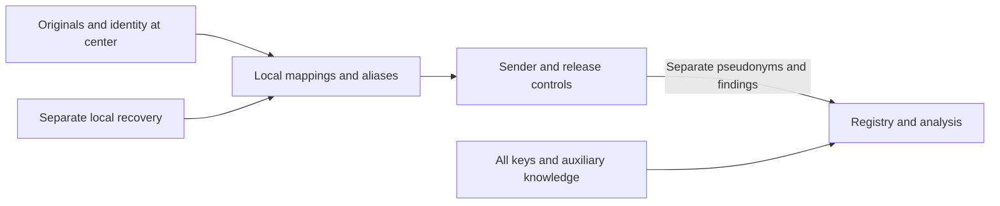

# Patient linkage under complete key compromise

This document describes the current linkage contract in
[Site_scoped_linkage_publication(2)(1).docx](<../patient_matching_lean/Site_scoped_linkage_publication(2)(1).docx>).
Scope and approval evidence belong to [HubTransfer.yml](../feature-tracking/HubTransfer.yml),
`linkage_manuscript_evidence`, and [Anonymization.yml](../feature-tracking/Anonymization.yml),
`incremental_reidentification_experiment`.

## Current contract

Source pseudonyms, patient hashes, identity salts and local mappings stay at the
center. The hub receives separately derived pseudonyms and approved clinical
data. Local storage prevents direct disclosure of source identifiers; it does
not prevent an attacker with the keys from recomputing the complete deterministic
derivation for demographic candidates. Testing a keyed hash-based message
authentication code (HMAC) against candidates is not decryption. Decryption
applies to encrypted originals and backups.

The evaluated storage alternative is a random, persistently stored mapping for
each necessary study or case context. It interrupts demographic recomputation
while preserving case relationships. It is a design alternative, not a deployed
production feature. Complete access to source data defeats its protection too.

## Assets and trust boundaries

Protected assets include original demographics, center keys and retained key
generations, local identifier mappings, approved media, computation integrity,
correct clinical linkage and recoverability. Import and API inputs, worker
requests, output parsing, exports, logs and recovery access cross relevant trust
boundaries. Build and test tooling is a separate trust domain.

`endoreg_db/utils/hashs.py` owns `get_patient_identity_fingerprint`,
`get_patient_uuid` and `get_hub_record_pseudonym`.
`endoreg_db/services/hub/hub_pseudonyms.py` transforms study references for the
recipient hub. Import, storage, transfer and research release require separate
controls; clinical content can itself identify a person.

The diagram describes the intended data flow, not verified administrative separation.

## Attacker scenarios

| Scenario | Attacker knowledge and access | Remaining boundary |
|---|---|---|
| A | All active and retained keys from all centers, registry data, algorithms, contexts and named candidates | No local mapping tables, originals, backups or unrestricted local identity-resolution queries |
| B | Scenario A plus all local databases, mappings, originals and backups | No confidentiality boundary for identities contained in those sources |

“All keys” includes storage, backup, signing and access keys. If these also grant
online source access, scenario B applies. Scenario A therefore assumes effective,
independent network and service permissions. Trusted Platform Modules (TPMs),
OpenBao, transport encryption and signatures provide no remaining secrecy for
already compromised keys. Actual deployment permissions require their own
verification; synthetic tests do not establish operational separation.

## Storage alternatives

| Construction | Case linkage | Scenario A | Scenario B |
|---|---|---|---|
| Current: demographics → HMAC → local UUIDv8 → hub HMAC UUIDv8 | Stable with the same resolver and context | Candidates can be recomputed through to the hub identifier | Source mappings or originals identify the person |
| Random persisted local UUID → existing hub derivation | Stable when reused with the same key generation | Demographics do not reveal the random UUID; a known local UUID plus the key still suffices | Exposed mappings defeat protection |
| Random persisted registry pseudonym per approved study or case, reverse mapping only at source | Findings and permitted follow-ups retain their identifier | No demographic key derivation; recognizable content remains vulnerable | Exposed reverse mappings identify the person |
| Additional encryption of the existing mapping | Unchanged | Protection requires the key or ciphertext to remain unavailable | Available key and ciphertext reveal the mapping |

A case is not necessarily a patient. Approved research requiring longitudinal
relationships across cases needs a study-specific patient identifier and separate
case identifiers. A global identifier across studies permits broader linkage.
Random mappings must be created atomically, uniquely and durably. Missing mappings
must block resolution; generating replacements on read would split identities.
Matching demographics do not prove that two records describe the same person.
Clinical identity checks, ambiguity handling, verified aliases, collision checks
and rollback remain migration prerequisites.

## Abuse paths and controls

| ID | Attack | Conditional likelihood / impact / priority | Control and residual limit |
|---|---|---|---|
| TM-K1 | Recompute candidates through to the hub identifier using known keys | High with candidate coverage / high / high | Keeping identifiers local prevents direct export, not recomputation; separate random mappings address this attack |
| TM-K2 | Read originals or decrypt mapping backups | High in scenario B / high / critical | Access separation can prevent B but provides no protection after B occurs |
| TM-K3 | Recognize a finding, image or date and propagate the identity through stable identifiers | Data-dependent / high / high | Minimize fields, review content, restrict linkage and assess cumulative releases; random tokens do not eliminate inference |
| TM-K4 | Use stolen access keys to query mappings or manipulate releases | Depends on independent access separation / high / high | Separate permissions, revoke access, enforce cumulative query budgets and protect audit records independently; signatures alone are insufficient |

These rankings are conditional judgments, not measured attack frequencies.
Registry roles must remain separate from reverse mappings, support access,
backups and logs. Central custody of identity salts is not authorized. Independent
local recovery domains improve availability, not anonymity.

Research releases must exclude original names and paths, direct identifiers and
unnecessary source fingerprints; necessary integrity checks remain internal.
Date precision, rare attributes, free text, images and accumulated releases need
recipient-specific assessment. On compromise, block transfers, revoke access,
establish the affected scope and enroll replacement credentials. Key rotation
does not make stolen information secret again.

## Verification contract and limits

`tests/services/test_hub_pseudonyms.py` exercises eight combinations of two
centers, two exposed key generations and current versus random local identifiers
through the production helpers. The attacker knows all keys. Current derivation
is the positive attack control. Tests cover recomputation, reuse within a case,
and recovery of either variant after disclosure of the source mapping.

A separate test models random study/case tokens, propagation of a known identity
within a case and failure when a mapping is missing. This is a test-only storage
alternative. An encryption test demonstrates that compromised keys reveal mapping
backups. The study-bundle test checks the export boundary.
`tests/services/test_patient_uuid_generation.py` covers persisted identifiers,
retained aliases and concurrent creation.

A failure to match a finite candidate set does not prove anonymity. Replacing the random local
identifier with the current derivation must invalidate the no-match expectation.
The alternative has no production persistence, concurrency or migration evidence.
Lean-P7 assumes key coverage over unknown keys and independent identifiers; it
does not prove protection for dependent derivations under known keys. Duplicate
demographic inputs are not digest collisions. Synthetic tests do not establish
clinical precision, sensitivity or attack prevalence.

## Registry operation and publication scope

A framework paper does not authorize registry operation. Each study needs a
documented purpose, necessity, a legal basis under Article 6 and an Article 9(2)
condition of the General Data Protection Regulation (GDPR). Authorization for
care is not blanket authorization for research. Required arrangements include
controller and processor roles under Articles 26/28, information and rights
procedures, processing records, retention periods and effective safeguards under
Articles 25, 32 and 89. High-risk processing requires a data protection impact
assessment, expressly including large-scale health-data processing; residual
high risk can require consultation under Article 36.
[GDPR](https://eur-lex.europa.eu/legal-content/EN/TXT/?uri=CELEX%3A32016R0679)

Where section 27 of the German Federal Data Protection Act applies, research
without consent requires necessity and a substantial predominance of research
interests. Its paragraph 3 requires anonymization as soon as possible under its
conditions, with identifying attributes stored separately until then and combined
only as necessary. The institution, federal state, hospital and professional law,
and applicable ethics procedures require specific review. Publishing the framework
or aggregate results differs from publishing personal registry data, for which
paragraph 4 imposes an additional restriction.
[Section 27 BDSG](https://www.gesetze-im-internet.de/bdsg_2018/BJNR209710017.html)

Identifiability depends on the recipient's context. Key compromise invalidates
separation assumptions that relied on those keys. Operations must continue to
treat the data as protected personal health data.
[CJEU C-413/23 P explanation](https://curia.europa.eu/site/upload/docs/application/pdf/2025-09/cp250107en.pdf)

The supported publication claim is controlled case linkage with source identities
kept locally. Current deterministic derivation does not resist candidate testing
after complete key compromise. Separate random mappings limit this attack but do
not guarantee anonymous clinical content or protection under complete source
access. Clinical quality, production approval and legal authorization require
separate evidence.
