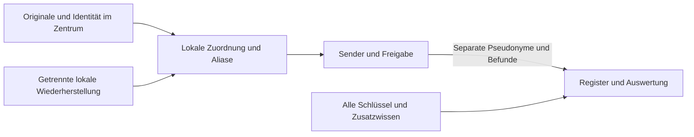

# Identitätszuordnung bei vollständigem Schlüsselverlust

Stand: 26.10.2026. Vertragsgrundlage:
[Site_scoped_linkage_publication(2)(1).docx](<../patient_matching_lean/Site_scoped_linkage_publication(2)(1).docx>).
Scope und Freigaben bleiben in [HubTransfer.yml](../feature-tracking/HubTransfer.yml),
`linkage_manuscript_evidence`, und [Anonymization.yml](../feature-tracking/Anonymization.yml),
`incremental_reidentification_experiment`. Historische Ergebnisse unten und im
[Experimentbericht](../scripts/reidentification/REPORT.md) bleiben historische Evidenz.

## Ergebnis und aktueller Vertrag

Quellpseudonyme, Patientenhashes, Salts und lokale Zuordnungen bleiben im Zentrum.
Der Hub erhält separat abgeleitete Pseudonyme und freigegebene klinische Daten.
Die Manuskriptabschnitte „Identifier derivation and resolution“ und „Identity
disclosure after key exposure“ benennen die Nachberechenbarkeit der vollständigen
Ableitung bei Schlüsselverlust ausdrücklich. Lokale Speicherung allein verhindert
sie nicht. HMAC-Kandidatenprüfung ist keine „Entschlüsselung“; dieser Begriff
betrifft verschlüsselte Originale und Sicherungen.

**Bevorzugte Zielvariante:** zufällige, dauerhaft lokal gespeicherte Zuordnung
pro notwendigem Studien-/Fallkontext. Sie unterbricht die demografische
Nachberechnung und erhält Fallbezüge. Sie ist eine bewertete Alternative,
keine mit dieser Änderung eingeführte Produktionsfunktion. Bei vollständigem
Quelldatenzugriff ist auch damit keine Nicht-Rückführbarkeit erreichbar.

## System und bestätigte Angreifermodelle

Python/Django verarbeitet lokale Identitätseingaben. `utils/hashs.py` enthält
`get_patient_identity_fingerprint`, `get_patient_uuid` und
`get_hub_record_pseudonym`; `services/hub/hub_pseudonyms.py` transformiert
Studienbezüge. `test_patient_uuid_generation.py` prüft gespeicherte UUIDs,
historische Aliase und konkurrierende Anlage. Schutzgüter sind Vertraulichkeit
der Personenidentität, korrekte klinische Zuordnung und Wiederherstellbarkeit.

Import, lokale Speicherung, Transfer und Forschungsfreigabe sind unterschiedliche
Vertrauensgrenzen. Das Diagramm zeigt den Soll-Datenfluss, keine gemessene
administrative Trennung. Klinische Inhalte können selbst identifizierend sein.

Der Auftraggeber bestätigte beide Szenarien am 26.10.2026:

| Szenario | Angreiferwissen und Zugriff | Verbleibende Grenze |
|---|---|---|
| A | Alle aktiven/historischen Schlüssel aller Zentren, Registerdaten, Algorithmen, Kontexte und benannte Kandidaten | Keine lokalen Zuordnungstabellen, Originale, Backups oder freien lokalen Zuordnungsoracles |
| B | Zusätzlich sämtliche lokalen Datenbanken, Zuordnungen, Originale und Backups | Keine Vertraulichkeitsgrenze für enthaltene Patientenidentitäten |

„Alle Schlüssel“ umfasst Speicher-, Backup-, Signatur- und Zugangsschlüssel.
Wenn diese auch Online-Zugriff auf die Quelle ermöglichen, gilt B. A setzt
weiterhin wirksame, unabhängige Netzwerk-/Dienstberechtigungen voraus. TPM,
OpenBao, Transportverschlüsselung und Signaturen werden bei bereits kompromittierten
Schlüsseln nicht als verbleibender Geheimnisschutz angerechnet. Tatsächliche
Deployment-Berechtigungen wurden nicht geprüft. Tests verwenden synthetische
Daten und sind keine Produktionsdienste.

## Speichervarianten

| Variante | Fallverknüpfung | Szenario A | Szenario B |
|---|---|---|---|
| Aktuell: Demografie → HMAC → lokale UUIDv8 → Hub-HMAC-UUIDv8 | Stabil bei gleichem Resolver/Kontext | Kandidaten bis zur Hub-Kennung nachrechenbar | Lokale Zuordnung/Originale identifizieren |
| Zufällige persistierte lokale UUID → bestehende Hub-Ableitung | Stabil bei Wiederverwendung und gleicher Schlüsselgeneration | Demografie liefert die zufällige UUID nicht; bekannte lokale UUID plus Schlüssel genügt dagegen | Zuordnung beseitigt Schutz |
| Bevorzugt: zufälliges persistiertes Registerpseudonym pro freigegebenem Studien-/Fallkontext, Rückzuordnung nur lokal | Befunde und zulässige Folgebeobachtungen behalten ihre Kennung | Keine demografische Schlüsselableitung; erkennbare Inhalte bleiben angreifbar | Entwendete Rückzuordnung identifiziert |
| Nur zusätzliche Verschlüsselung der bisherigen Zuordnung | Unverändert | Schutz nur solange Schlüssel oder Ciphertext fehlen | Mit verfügbarem Schlüssel und Ciphertext lesbar |

Ein Fall ist nicht automatisch ein Patient. Benötigt die genehmigte Registerfrage
fallübergreifende Verläufe, braucht sie eine studiengebundene Patientenkennung
mit getrennten Fallkennungen. Eine globale Kennung über sämtliche Studien ist
weitergehend. Zufällige Zuordnungen müssen atomar, eindeutig und dauerhaft
angelegt werden. Fehlende Zuordnungen blockieren die Auflösung; Neuauswürfeln
würde Fälle spalten. Gleiche Demografie beweist keine Personengleichheit.
Klinische Identitätsprüfung, Mehrdeutigkeitsbehandlung, geprüfte Aliase,
Kollisionsprüfung und Rollback bleiben Voraussetzungen einer Migration.

## Angriffswege und Maßnahmen

| ID | Angriff | Bedingte Wahrscheinlichkeit / Schwere / Priorität | Kontrolle und Restgrenze |
|---|---|---|---|
| TM-K1 | Kandidaten mit bekannten Schlüsseln bis zur aktuellen Hub-Kennung nachrechnen | Hoch bei Kandidatenabdeckung / hoch / hoch | Lokaler Verbleib verhindert direkten Export, nicht Nachberechnung; zufällige getrennte Zuordnung ist die vorgeschlagene Abhilfe |
| TM-K2 | Originale oder entschlüsselbare Mapping-Backups lesen | Hoch im definierten B / hoch / kritisch | Zugriffstrennung kann B verhindern, keinen Schutz nach seinem Eintritt begründen; bereits bekannte Originalidentität ist kein neuer kryptografischer Gewinn |
| TM-K3 | Bekannter Befund, Bild oder Datum identifiziert einen Fall; stabile Kennung verbreitet das Label | Datenabhängig / hoch / hoch | Feldminimierung, Inhaltsprüfung, begrenzte Verknüpfung und kumulative Release-Prüfung; Zufallstoken beseitigen Inferenz nicht |
| TM-K4 | Gestohlene Zugangsschlüssel ermöglichen Zuordnungsabfragen oder manipulierte Freigaben | Abhängig von unabhängiger Zugriffstrennung / hoch / hoch | Getrennte Berechtigungen, Sperrung, kumulative Query-Budgets und extern geschützte Auditierung; Signaturen allein reichen nicht |

Die Ränge sind bedingte Bewertungen, keine gemessenen Angriffshäufigkeiten.
Lokale Rückzuordnungen, Supportzugänge, Backups und Logs müssen von Registerrollen
getrennt bleiben. Zentrale Salt-Verwahrung wird nicht autorisiert. Zwei unabhängig
wiederherstellbare lokale Speicherdomänen dienen Verfügbarkeit, nicht Anonymität.
TPM/OpenBao bleiben Prävention, kein Schutz nach angenommenem Komplettschlüsselverlust.

Forschungsfreigaben müssen Originalnamen/-pfade, direkte Identifikatoren und
unnötige Quellfingerprints ausschließen; notwendige Integritätschecks bleiben
intern. Datumsgenauigkeit, seltene Merkmale, Freitexte, Bilder und frühere Releases
benötigen eigene Empfängerprüfung. Bei Kompromittierung: Transfers sperren,
Zugänge widerrufen, Umfang feststellen und neu enrollen. Rotation macht bereits
entwendete Informationen nicht wieder geheim.

## Testvertrag und Evidenzgrenzen

`tests/services/test_hub_pseudonyms.py` vergleicht über die Produktionshelfer
acht Kombinationen aus zwei Zentren, zwei exponierten Generationen und aktueller
gegenüber zufälliger lokaler UUID. Der Angreifer kennt jeweils alle Schlüssel.
Die aktuelle Ableitung ist die positive Angriffskontrolle. Geprüft werden
Nachberechnung, Wiederverwendung im Fall und erfolgreiche Rückführung beider
Varianten nach Offenlegung der lokalen Zuordnung. Ein weiterer Test modelliert
ausdrücklich nur die Zielvariante mit zufälligen Fall-/Studientoken, Labelweitergabe
innerhalb eines Falls und Fehler bei fehlender Zuordnung. Ein echter
Verschlüsselungstest zeigt lesbare Mapping-Sicherungen nach Schlüsselverlust.
Der vorhandene Studienbündeltest prüft weiterhin die Exportgrenze.

Ein Nulltreffer im begrenzten Kandidatensatz beweist keine Anonymität. Ersetzt man
die zufällige lokale UUID durch die aktuelle Ableitung, muss die Erwartung des
fehlenden Treffers scheitern. Die Zielvariante hat hier keine Persistenz-,
Parallelitäts- oder Migrationsevidenz. Der bestehende isolierte Angriffsharness
ergänzt diese Regressionen; seine alten Messzahlen werden nicht als Messung von
B oder einer neuen Speicherimplementierung umetikettiert. Lean-P7 setzt
Schlüsselüberdeckung über unbekannte Schlüssel und unabhängige UUIDs voraus;
es beweist keinen Schutz der abhängigen Ableitung bei bekanntem Schlüssel.

## Registerstudie in Deutschland und Publikationsaussage

Ein Framework-Paper erlaubt keinen Registerbetrieb. Für die konkrete Studie sind
Zweck, Erforderlichkeit, Rechtsgrundlage nach Artikel 6 und Bedingung nach Artikel
9 Absatz 2 DSGVO zu dokumentieren. Behandlungsbefugnis ist keine pauschale
Forschungsfreigabe. Erforderlich sind Rollenklärung nach Artikel 26/28,
Informations-/Rechteverfahren, Verarbeitungsverzeichnis und Löschfristen sowie
wirksame Maßnahmen nach Artikel 25, 32 und 89. Bei hohem Risiko ist eine
Datenschutz-Folgenabschätzung nötig, bei umfangreicher Gesundheitsdatenverarbeitung
ausdrücklich; verbleibendes hohes Risiko kann die Konsultation nach Artikel 36
erfordern. [DSGVO](https://eur-lex.europa.eu/legal-content/EN/TXT/?uri=CELEX%3A32016R0679)

Soweit §27 BDSG gilt, verlangt Forschung ohne Einwilligung insbesondere
Erforderlichkeit und erhebliches Überwiegen der Forschungsinteressen. Absatz 3
verlangt frühestmögliche Anonymisierung unter seinen Voraussetzungen und bis dahin
getrennte Speicherung der Zuordnungsmerkmale, mit Zusammenführung nur soweit
erforderlich. Institution, Bundesland, Krankenhaus-/Berufsrecht und gegebenenfalls
Ethikverfahren müssen konkret geprüft werden; die Institution wurde nicht
spezifiziert. Die Veröffentlichung des Frameworks und aggregierter Ergebnisse
ist von der Veröffentlichung personenbezogener Registerdaten zu trennen;
für Letztere enthält §27 Absatz 4 eine zusätzliche Einschränkung.
[BDSG §27](https://www.gesetze-im-internet.de/bdsg_2018/BJNR209710017.html)

Empfängerbezogene Identifizierbarkeit bleibt kontextabhängig. Bei kompromittierten
Schlüsseln darf eine frühere Trennungsannahme nicht fortgeschrieben werden.
Betriebsannahme bleiben geschützte personenbezogene Gesundheitsdaten.
[EuGH C-413/23 P, amtliche Erläuterung](https://curia.europa.eu/site/upload/docs/application/pdf/2025-09/cp250107en.pdf)

Publizierbar ist die begrenzte Aussage: **Kontrollierte Fallverknüpfung mit lokal
gehaltenen Quellidentitäten; kein Schutz der aktuellen deterministischen Ableitung
gegen Kandidatenprüfung nach vollständigem Schlüsselverlust. Getrennte zufällige
Zuordnungen begrenzen diesen Angriff, gewährleisten aber weder Anonymität klinischer
Inhalte noch Schutz bei vollständigem Quelldatenzugriff.** Klinische Qualität,
Produktionsfreigabe und rechtliche Zulässigkeit benötigen gesonderte Nachweise.

## Historische Bewertung zum früheren Manuskript

Der folgende Abschnitt bleibt als historische Einordnung der früheren
Zwei-Parteien-Auswertung erhalten; seine Annahmen ersetzen nicht A/B oben.

Scope: site-local inputs, the experimental A/B comparison, hub transfer and
release disclosure. This companion records the evidence behind Supplement S2 of
`patient_matching_lean/infrastructure_lx_annotate_linkage_research_revised.docx`.
Feature readiness remains in `feature-tracking/HubTransfer.yml`; implementation
work in progress is not treated as a validated control.

## Assets and trust boundaries

Original demographic tuples, site HMAC keys and retained generations, UUID
relationships, approved media, and computation integrity are protected assets.
Import/API inputs, worker requests, output parsers, exports, logs and recovery
access are relevant entry points. Build/test tooling is a separate trust domain.

The historical measured prototype used
two processes on one host, shared administration, plaintext localhost peers and
incremental outputs to both parties. It does not demonstrate independent
administration or the proposed minimum-output policy.

## Evidence and conditional ranking

| Abuse path | Conditional likelihood; impact; priority | Evidence and control |
|---|---|---|
| Obtain retained key and target tokens, then test demographic guesses | Frequency unmeasured; high; high where exposed | `endoreg_db/utils/hashs.py:get_identity_salt_fingerprint`; LuxNix `scripts/provision-identity-salts.py` gives application/root access. Inventory actual recovery and backup privileges. |
| Substitute UUID or fabricate a formally valid candidate | Medium where assertions are accepted; high; high | `patient_matching_lean/PatientMatching/Core.lean:candidate_uuid_substitution`; `Workflow.lean:Checks`. Local snapshot binding and authenticated worker completion are implementation obligations. |
| Adapt fresh or overlapping membership queries | Medium with repeat access; high; high | `PatientMatching/Privacy.lean:exact_membership_distinguishes`. Existing transfer replay controls do not imply cumulative matching budgets. |
| Attribute released records through known content or metadata | Medium with relevant auxiliary information; high; high | `docs/patient_matching_2pc_assessment.md`, artifact-identity and export analysis. Field allowlists and release UUIDs address particular channels, not all content recognition. |
| Exhaust worker resources or exploit partial output before abort | Medium with worker access; medium; medium | Assessment measurements: 100 candidates, 171.815 s, 32,482.8 MB. Bounded execution limits work; aggregate output and cancellation behaviour require independent verification. |

These ordinal rankings are scenario judgments, not incident probabilities or a
numeric risk score. Effective privilege assignments, collusion frequency and
recipient knowledge were not measured. The user previously requested inspection
of LuxNix instead of assuming separate administration; its source configuration
does not settle those runtime questions.

## Quantification and interpretation

Supplement S3 supplies reproducible conditional calculations: the ideal
256-bit accidental-collision union bound, a uniform-key guessing bound,
aggregate-output cardinality, illustrative membership-query coverage and an
exact zero-success binomial upper limit for a future attack study.

None is labelled an empirical patient-identification probability. Duplicate
demographic inputs are not digest collisions. A disclosed authorized relationship
can identify a source record to a party that already knows its local patient.
The benchmark's repeated synthetic tuples cannot estimate clinical linkage
precision, sensitivity or attack prevalence.

## Mitigation and evaluation priorities

Keep keys and original tuples within their respective controlled workers;
inventory application, root, database and recovery access before claiming
independent administration. Bind computations to authorized immutable records
and enrolled generations. Release aggregate results to the designated recipient,
persist signed session acceptance atomically, and enforce query budgets across
fresh sessions. Test malformed inputs, changes during execution, revocation and
interruption separately from ordinary correctness.

Assess public content release independently through known-content and
auxiliary-information attacks. Clinical adjudication, representative sampling,
false-attribution counts and confidence intervals would improve risk
calibration. No clinical safety or production approval is inferred from the paper.
